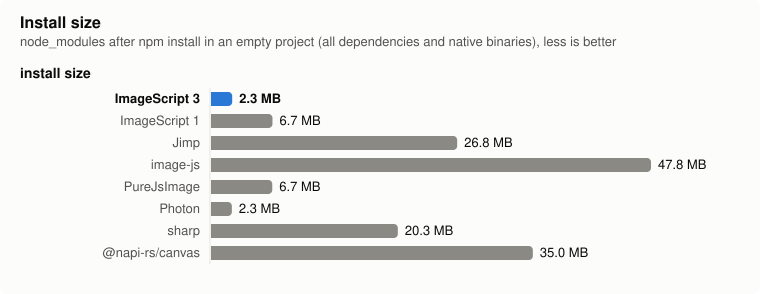
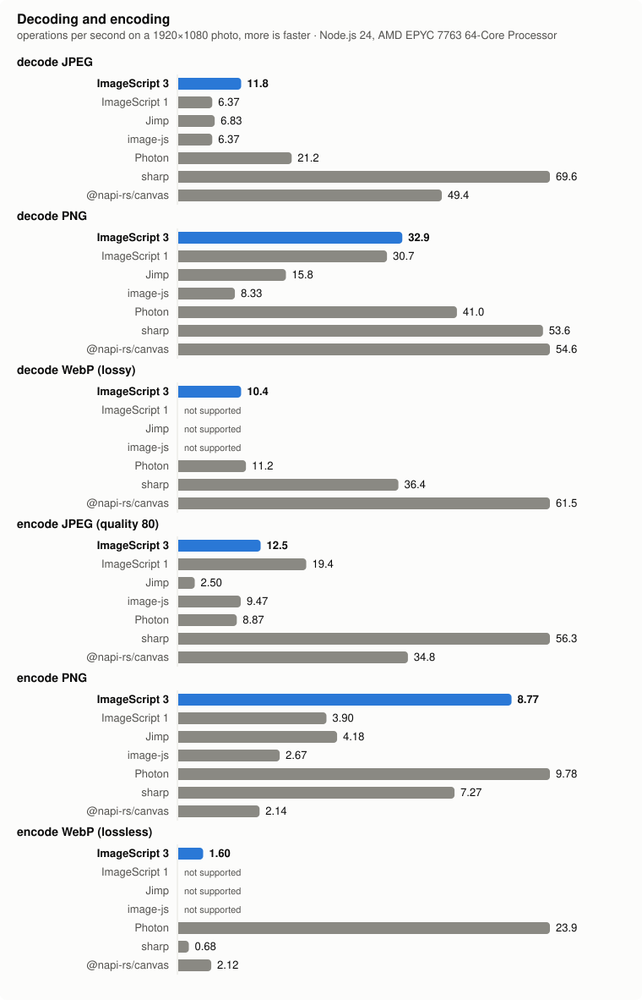
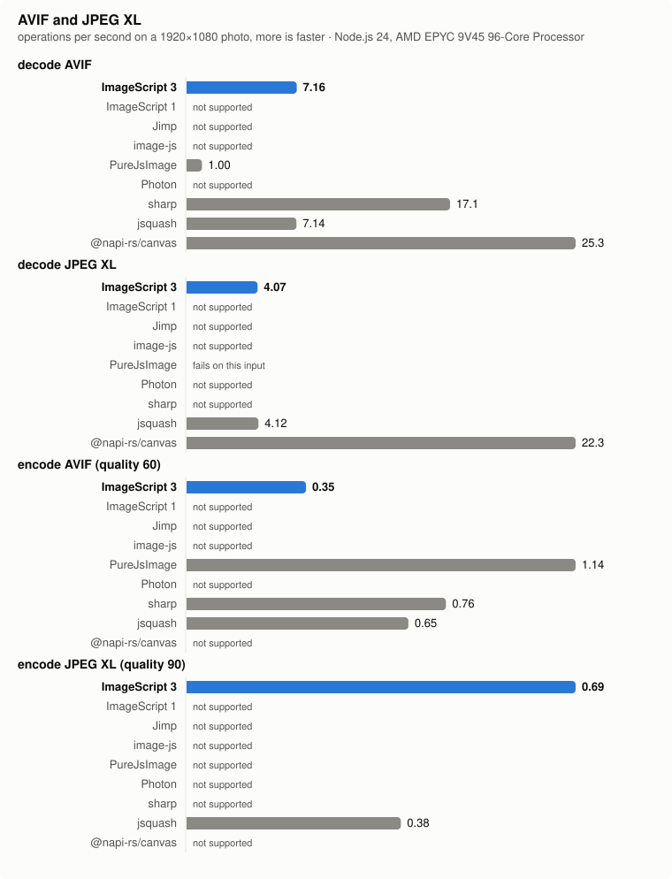
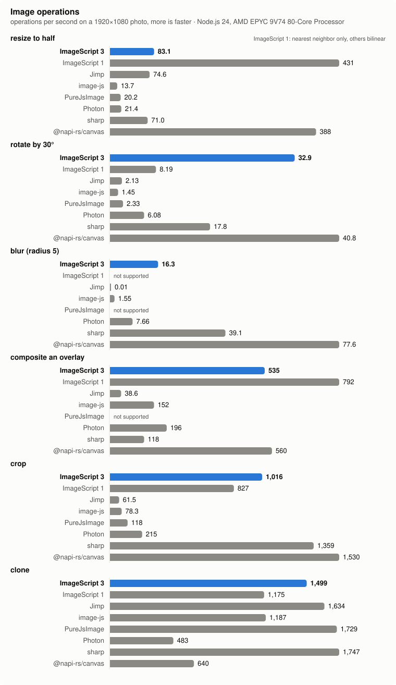
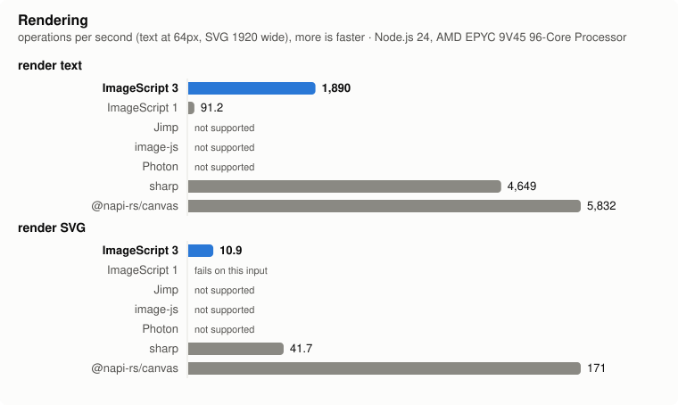
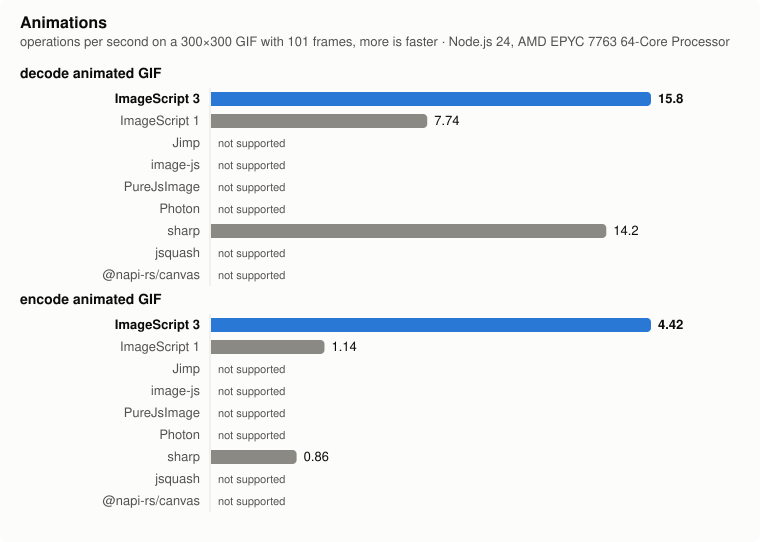
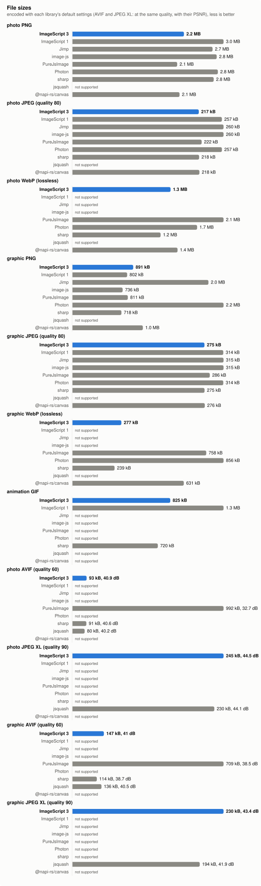

# ImageScript benchmark

How [ImageScript](https://github.com/matmen/ImageScript) compares to other image libraries for Node.js: speed, file
sizes and what installing each takes. ImageScript is plain JavaScript with no dependencies, so it runs wherever
JavaScript does, like Jimp, image-js and PureJsImage; sharp and @napi-rs/canvas wrap native libraries (libvips, Skia),
Photon and ImageScript 1 are WebAssembly, and so is jsquash (Squoosh's libavif and libjxl, for AVIF and JPEG XL).

## Numbers

Operations per second (more is faster), measured 2026-10-30 with Node.js v24.22.1 on AMD EPYC 9V45 96-Core Processor, ImageScript 3.12.1.

| | **ImageScript 3** | **ImageScript 1** | **Jimp** | **image-js** | **PureJsImage** | **Photon** | **sharp** | **jsquash** | **@napi-rs/canvas** |
|---|--:|--:|--:|--:|--:|--:|--:|--:|--:|
| decode JPEG | **21.1** | 10.6 | 9.71 | 9.38 | 12.9 | 32.3 | 103 | – | 78.3 |
| decode PNG | **47.9** | 35.0 | 28.6 | 13.9 | 20.6 | 59.1 | 76.1 | – | 73.0 |
| decode WebP (lossy) | **18.7** | – | – | – | 15.3 | 15.8 | 54.9 | – | 93.5 |
| encode JPEG (quality 80) | **21.7** | 30.6 | 4.14 | 14.8 | 10.9 | 15.4 | 86.7 | – | 58.3 |
| encode PNG | **11.1** | 6.55 | 6.56 | 5.02 | 2.71 | 15.4 | 10.3 | – | 2.91 |
| encode WebP (lossless) | **1.23** | – | – | – | 0.58 | 36.1 | 1.01 | – | 3.03 |
| decode AVIF | **7.16** | – | – | – | 1.00 | – | 17.1 | 7.14 | 25.3 |
| decode JPEG XL | **4.07** | – | – | – | fails | – | – | 4.12 | 22.3 |
| encode AVIF (quality 60) | **0.35** | – | – | – | 1.14 | – | 0.76 | 0.65 | – |
| encode JPEG XL (quality 90) | **0.69** | – | – | – | – | – | – | 0.38 | – |
| resize to half | **119** | 534 | 104 | 18.5 | 25.8 | 28.5 | 185 | – | 361 |
| rotate by 30° | **38.4** | 10.2 | 2.82 | 2.12 | 3.43 | 7.85 | 39.4 | – | 45.8 |
| blur (radius 5) | **23.3** | – | 0.02 | 2.49 | – | 11.3 | 110 | – | 88.9 |
| composite an overlay | **677** | 946 | 57.3 | 207 | – | 270 | 291 | – | 705 |
| crop | **1,204** | 1,138 | 87.3 | 114 | 150 | 313 | 1,616 | – | 1,774 |
| clone | **1,463** | 1,327 | 1,265 | 1,188 | 1,568 | 628 | 1,684 | – | 807 |
| render text | **4,165** | 91.4 | – | – | – | – | 3,019 | – | 2,967 |
| render SVG | **9.96** | fails | – | – | – | – | 43.7 | – | 160 |
| decode animated GIF | **26.6** | 13.1 | – | – | – | – | 20.9 | – | – |
| encode animated GIF | **7.30** | 1.98 | – | – | – | – | 1.44 | – | – |

Encoded sizes:

| | **ImageScript 3** | **ImageScript 1** | **Jimp** | **image-js** | **PureJsImage** | **Photon** | **sharp** | **jsquash** | **@napi-rs/canvas** |
|---|--:|--:|--:|--:|--:|--:|--:|--:|--:|
| photo PNG | 2.2 MB | 3.0 MB | 2.7 MB | 2.8 MB | 2.1 MB | 2.8 MB | 2.8 MB | – | 2.1 MB |
| photo JPEG | 217 kB | 257 kB | 260 kB | 260 kB | 222 kB | 257 kB | 218 kB | – | 218 kB |
| photo WebP | 1.3 MB | – | – | – | 2.1 MB | 1.7 MB | 1.2 MB | – | 1.4 MB |
| graphic PNG | 891 kB | 802 kB | 2.0 MB | 736 kB | 811 kB | 2.2 MB | 718 kB | – | 1.0 MB |
| graphic JPEG | 275 kB | 314 kB | 315 kB | 315 kB | 286 kB | 314 kB | 275 kB | – | 276 kB |
| graphic WebP | 277 kB | – | – | – | 758 kB | 856 kB | 239 kB | – | 631 kB |
| animation GIF | 825 kB | 1.3 MB | – | – | – | – | 720 kB | – | – |
| photo AVIF | 93 kB, 40.9 dB | – | – | – | 992 kB, 32.7 dB | – | 91 kB, 40.6 dB | 80 kB, 40.2 dB | – |
| photo JPEG XL | 245 kB, 44.5 dB | – | – | – | – | – | – | 230 kB, 44.1 dB | – |
| graphic AVIF | 147 kB, 41 dB | – | – | – | 709 kB, 38.5 dB | – | 114 kB, 38.7 dB | 136 kB, 40.5 dB | – |
| graphic JPEG XL | 230 kB, 43.4 dB | – | – | – | – | – | – | 194 kB, 41.9 dB | – |

| | **ImageScript 3** | **ImageScript 1** | **Jimp** | **image-js** | **PureJsImage** | **Photon** | **sharp** | **jsquash** | **@napi-rs/canvas** |
|---|---|---|---|---|---|---|---|---|---|
| kind | JavaScript | WebAssembly | JavaScript | JavaScript | JavaScript | WebAssembly | native (libvips) | WebAssembly | native (Skia) |
| package | `imagescript@3.12.1` | `imagescript@1.3.1` | `jimp@1.6.1` | `image-js@1.7.1` | `purejsimage@0.17.0` | `@silvia-odwyer/photon-node@0.3.4` | `sharp@0.35.5` | `@jsquash/avif@2.1.1 @jsquash/jxl@1.3.0` | `@napi-rs/canvas@1.0.11` |
| install size | 2.4 MB | 6.7 MB | 26.8 MB | 47.8 MB | 6.7 MB | 2.3 MB | 20.3 MB | 14.2 MB | 35.0 MB |
| packages | 1 | 1 | 64 | 55 | 1 | 1 | 6 | 3 | 2 |

## Method

- Inputs (in `inputs/`, sources in [inputs/SOURCES.md](inputs/SOURCES.md)): a 1920×1080 photo (JPEG, and made from it
  when the benchmark starts, PNG, lossy WebP, AVIF by sharp (libaom) and JPEG XL by jsquash (libjxl, effort 7), both
  at the qualities below), a 1434×1434 graphic with transparency (PNG), a 445×445 diagram with transparency placed on
  the photo (PNG), a 300×300 GIF with 101 frames.
- AVIF and JPEG XL are encoded at the same nominal quality (60 and 90); as the libraries' scales differ,
  the file sizes come with their PSNR (of the color over black, decoded by libavif and libjxl). PureJsImage's AVIF
  encoder has no quality option, and its JPEG XL decoder doesn't support everything libjxl's files use, which shows as
  failing. jsquash only encodes and decodes AVIF and JPEG XL (it gets the other inputs as pixels); @napi-rs/canvas
  decodes both with Skia's codecs, but doesn't encode them.
- Rendering: "The quick brown fox jumps over the lazy dog, 0123456789" in Source Sans 3 at 64px, and `tests/svgs/features.svg` (gradients, clipping,
  CSS) at 1920 pixels wide. Jimp, image-js, PureJsImage and Photon can't render TrueType/OpenType fonts or SVGs; ImageScript 1 crashes
  on this SVG; @napi-rs/canvas (Skia's SVG module) ignores its CSS, so it draws a little less.
- Every operation starts from the same decoded image and returns a new one: libraries that change images in place
  clone first, sharp runs a pipeline from raw pixels back to raw pixels, PureJsImage (which has no decoded images) one
  from a BMP back to a BMP, @napi-rs/canvas draws into a new canvas. PureJsImage has no blur, composite, rendering or
  animated GIFs.
- Where the library lets you choose, resizing is bilinear (ImageScript 1 only has nearest neighbor), blurring is
  gaussian with a radius or sigma of 5, rotating grows the image to fit. Each library uses its own defaults
  otherwise, e.g. its PNG compression level.
- Threads: ImageScript uses worker threads where they pay off (the processors available, at most 8), and sharp gets
  as many (`sharp.concurrency()`; its default on glibc Linux without jemalloc, like on CI, is one). The other
  libraries run on one thread (jsquash turns its threaded builds off in Node).
- [tinybench](https://github.com/tinylibs/tinybench), at least 1.5 seconds and 3 runs per measurement, every library
  in its own process.
- The release workflow runs the benchmark for every release and commits the results, on a GitHub Actions runner;
  runners vary, so compare libraries within one run rather than between runs.
- Install sizes: `npm install <library>` in an empty project, the apparent size of `node_modules`.

Run it: `npm install` in this directory, then `node run.js` (on an idle machine; `IMAGESCRIPT=local` measures
this checkout after `npm run build` instead of the version from npm), `node installs.js` and `node report.js`.
